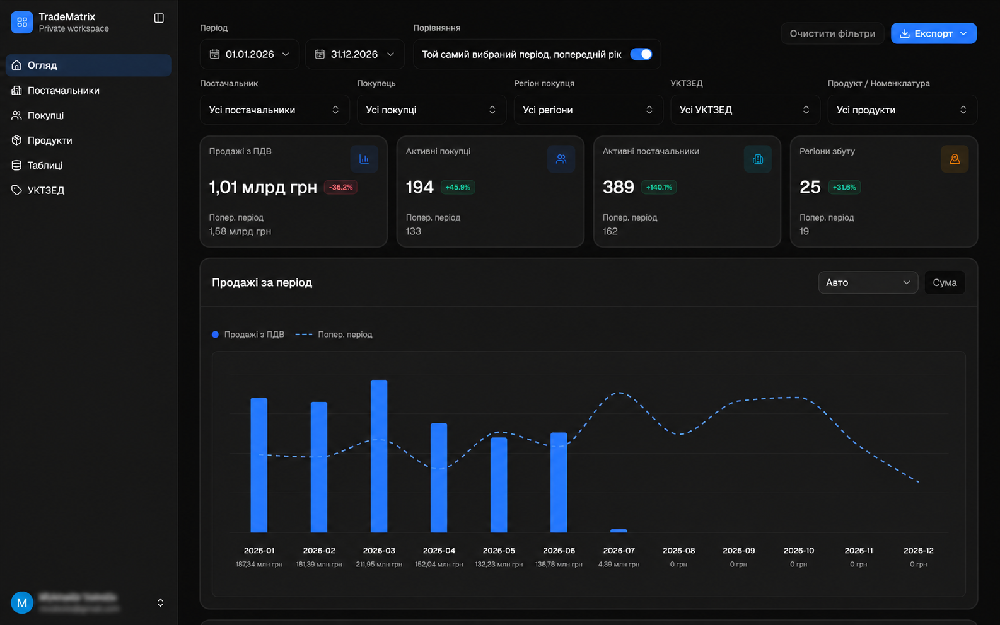

# TradeMatrix

TradeMatrix is a private-workspace analytics dashboard for exploring market data across sales, purchases, buyers, suppliers, products, and regions. The dashboard combines date and dimension filters, period comparisons, KPI summaries, charts, rankings, detailed tables, and data exports.



## Product overview

The public `/` route is currently a temporary entry page. The authenticated application lives under `/app`; after signing in, users land on the overview dashboard.

### Main sections

| Section        | Route                 | Purpose                                                               |
| -------------- | --------------------- | --------------------------------------------------------------------- |
| Overview       | `/app`                | KPIs, trends, market structure, insights, rankings, and detailed data |
| Suppliers      | `/app/suppliers`      | Supplier analytics and tables                                         |
| Buyers         | `/app/buyers`         | Buyer analytics and tables                                            |
| Products       | `/app/products`       | Product and catalog analytics                                         |
| Tables         | `/app/tables`         | Tabular views of market data                                          |
| UKTZED         | `/app/uktzed`         | Classification browser (currently marked as in progress in the menu)  |
| Settings       | `/app/settings`       | General settings and security                                         |
| Analytics      | `/app/analytics`      | Additional analytics views                                            |
| Sales          | `/app/sales`          | Sales data                                                            |
| Purchases      | `/app/purchases`      | Purchase data                                                         |
| Counterparties | `/app/counterparties` | Combined counterparty directory                                       |

Authentication and account recovery routes include `/app/sign-in`, `/app/sign-up`, `/app/forgot-password`, `/app/reset-password`, `/app/change-password`, `/app/verify-code`, `/app/two-fa`, `/app/setup-2fa`, `/app/check-your-inbox`, and `/app/password-changed`.

## Overview workflow

1. Choose a date range in the filter bar.
2. Optionally compare it with another period and filter by supplier, buyer, region, UKTZED code, or product.
3. Review KPI cards, sales and purchase trends, market structure, and insights.
4. Open a ranking or table record to explore a specific entity.
5. Export available data as CSV/XLSX or generate a PDF report.

Overview filter state is reflected in the URL and saved in the browser, so a filtered view can be shared or revisited.

## Technology

- Next.js 16 App Router, React 19, and TypeScript
- Tailwind CSS 4, shadcn/ui with Base UI primitives, and Lucide icons
- TanStack Query for server state and caching; TanStack Table for data tables; Zustand for session and client state
- Recharts for charts; Zod and React Hook Form for forms
- `html2canvas` and `jspdf` for PDF generation
- pnpm

## Architecture

```text
src/app/                  App Router pages and /app routes
src/app/app/(auth)/       Sign-in and account recovery pages
src/app/app/(private)/    Protected workspace pages
src/components/           Application shell, feature components, and UI
src/components/overview/  Overview dashboard and widgets
src/components/auth/      Authentication forms, route guards, and 2FA
src/lib/api/              Shared HTTP client
src/lib/auth/             Authentication API and session stores
src/lib/overview/         Overview API, queries, filters, and URL state
src/lib/*/                APIs and logic for other product domains
```

The private layout at `src/app/app/(private)/layout.tsx` provides the sidebar, mobile navigation, and route protection. Navigation items are defined in `src/components/app-sidebar.tsx`. The overview is composed from `OverviewDashboardClient`, `OverviewDashboardScreen`, and focused dashboard widgets.

A typical data request flows from a TanStack Query hook to a domain API function in `src/lib/<domain>/`, then through the shared `src/lib/api/http-client.ts`, which attaches session credentials and handles errors and session refresh.

## Run locally

Requirements: Node.js and pnpm. From the repository root:

```bash
pnpm install
pnpm dev
```

Open `http://localhost:3000`. Sign-in is at `http://localhost:3000/app/sign-in`.

The frontend sends API requests to `NEXT_PUBLIC_API_URL`, defaulting to `http://localhost:8000`. The backend is maintained separately and must be running or available in a test environment. Set local configuration in `.env.local`; never commit environment files, credentials, or tokens.

Useful commands:

```bash
pnpm dev           # Start the development server
pnpm build         # Create a production build
pnpm start         # Run the production build
pnpm lint          # Run ESLint
pnpm format:check  # Check formatting with Prettier
```

## Authentication and access

Private routes are protected by `PrivateRouteGuard`. When a session is missing, the app attempts to restore it with a refresh cookie and redirects to `/app/sign-in` if restoration fails. Session state is managed with Zustand and synchronized between tabs.

This repository does not include a demo login or test password. Local sign-in requires the separately maintained backend and a valid test account.
