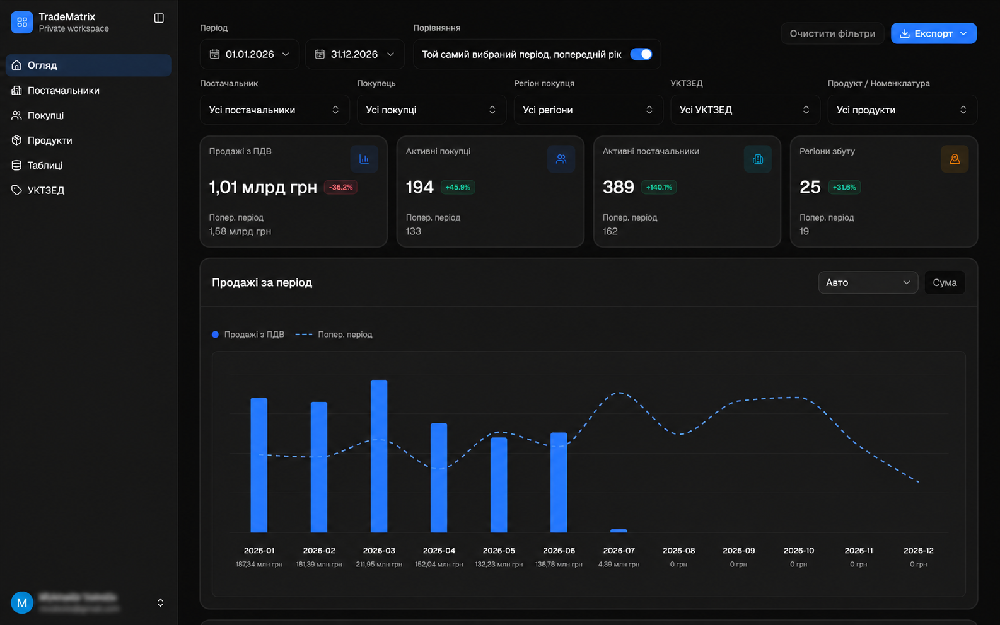

# TradeMatrix — огляд проєкту

TradeMatrix — вебзастосунок для перегляду й аналізу ринкових даних про продажі, закупівлі, контрагентів, продукти та регіони. Цей документ пояснює структуру інтерфейсу, основні сценарії користувача й те, як запустити фронтенд локально.

> **Дані та скриншоти.** Нижче є реальний знімок робочого простору.

## Швидке знайомство

Публічний маршрут `/` наразі є тимчасовою сторінкою з посиланням на робочий простір. Основна частина продукту розміщена під `/app` і вимагає авторизації. Після входу користувач потрапляє на оглядовий дашборд.



### Основні розділи

| Розділ меню   | Маршрут               | Для чого                                                                 |
| ------------- | --------------------- | ------------------------------------------------------------------------ |
| Огляд         | `/app`                | KPI, динаміка, структура ринку, інсайти, рейтинги й деталізована таблиця |
| Постачальники | `/app/suppliers`      | Аналітика та таблиця постачальників                                      |
| Покупці       | `/app/buyers`         | Аналітика та таблиця покупців                                            |
| Продукти      | `/app/products`       | Аналітика за товарами та номенклатурою                                   |
| Таблиці       | `/app/tables`         | Табличне представлення даних                                             |
| УКТЗЕД        | `/app/uktzed`         | Розділ класифікатора; в меню позначений як такий, що готується           |
| Налаштування  | `/app/settings`       | Загальні налаштування та безпека                                         |
| Аналітика     | `/app/analytics`      | Окремий аналітичний розділ                                               |
| Продажі       | `/app/sales`          | Дані про продажі                                                         |
| Закупівлі     | `/app/purchases`      | Дані про закупівлі                                                       |
| Контрагенти   | `/app/counterparties` | Загальний список контрагентів                                            |

Сторінки входу та відновлення доступу знаходяться за `/app/sign-in`, `/app/sign-up`, `/app/forgot-password`, `/app/reset-password`, `/app/change-password`, `/app/verify-code`, `/app/two-fa`, `/app/setup-2fa`, `/app/check-your-inbox` і `/app/password-changed`.

## Як користуватися оглядом

1. Установіть період у верхній панелі фільтрів.
2. За потреби ввімкніть порівняння періодів і звузьте вибір за постачальником, покупцем, регіоном, УКТЗЕД або продуктом.
3. Перегляньте картки KPI, графік продажів/закупівель, структуру ринку й інсайти.
4. Перейдіть із рейтингу до відповідного розділу або відкрийте запис таблиці для аналізу деталей.
5. Експортуйте доступні дані у CSV/XLSX або сформуйте PDF-звіт.

Стан фільтрів огляду зберігається в параметрах URL і локально в браузері. Це дає змогу поділитися посиланням на той самий набір фільтрів і повернутися до останнього перегляду.

## Авторизація та доступ

Приватні маршрути обгорнуті `PrivateRouteGuard`. Якщо сесії немає, застосунок намагається відновити її через refresh-cookie; після невдачі перенаправляє на `/app/sign-in`. Стан сесії зберігається в Zustand і синхронізується між вкладками.

У репозиторії немає вбудованого демо-входу або тестового пароля. Для локального входу потрібен бекенд і чинний тестовий обліковий запис. Не записуйте паролі, токени чи вміст `.env` у документацію.

## Технології

- Next.js 16 App Router, React 19, TypeScript.
- Tailwind CSS 4, shadcn/ui із компонентами на Base UI, Lucide.
- TanStack Query для запитів і кешу; TanStack Table для таблиць; Zustand для сесій та деякого стану клієнта.
- Recharts для графіків, Zod і React Hook Form для форм.
- `html2canvas` і `jspdf` для формування PDF.
- Пакетний менеджер — pnpm.

## Структура коду

```text
src/app/                 App Router: публічна сторінка та маршрути /app
src/app/app/(auth)/      сторінки входу й відновлення доступу
src/app/app/(private)/   захищені сторінки робочого простору
src/components/          оболонка застосунку, функціональні блоки та UI
src/components/overview/ оглядовий дашборд і його віджети
src/components/auth/    форми входу, захист маршрутів і 2FA
src/lib/api/             спільний HTTP-клієнт
src/lib/auth/            API авторизації та сесійні стори
src/lib/overview/        API, запити, фільтри та стан URL огляду
src/lib/*/               API та логіка інших предметних розділів
```

У приватній оболонці `src/app/app/(private)/layout.tsx` розміщені бокове меню, мобільний перемикач меню та захист доступу. Навігаційні пункти меню визначені в `src/components/app-sidebar.tsx`. Екран огляду збирається з клієнтського контейнера `OverviewDashboardClient`, презентаційного екрана `OverviewDashboardScreen` і окремих компонентів-карток.

Типовий потік запиту: компонент викликає хук TanStack Query → хук використовує функцію з `src/lib/<domain>/*-api.ts` → спільний `src/lib/api/http-client.ts` додає токен і обробляє помилки/оновлення сесії → відповідь відображається у компонентах розділу.

## Локальний запуск

Потрібні Node.js і pnpm. У корені репозиторію:

```bash
pnpm install
pnpm dev
```

Відкрийте `http://localhost:3000`. Для входу відкрийте `http://localhost:3000/app/sign-in`.

Фронтенд надсилає API-запити на `NEXT_PUBLIC_API_URL`; якщо змінну не задано, використовується `http://localhost:8000`. Значення можна задати в локальному `.env.local` відповідно до середовища бекенду. Сам бекенд не входить до цього репозиторію, тому його потрібно запускати окремо або підключити доступне тестове середовище. Не публікуйте локальні env-файли.

Корисні команди з `package.json`:

```bash
pnpm dev           # локальна розробка
pnpm build         # production-збірка
pnpm start         # запуск зібраного застосунку
pnpm lint          # ESLint
pnpm format:check  # перевірка форматування Prettier
```

## Де додати скриншоти

Зберігайте лише знеособлені скриншоти в `docs/assets/screenshots/` і вставляйте відносними посиланнями, наприклад:

```md

```

Перед додаванням перевірте, що на зображенні немає персональних даних, назв реальних контрагентів, податкових номерів, секретів чи даних, які не призначені для публікації.
